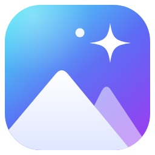
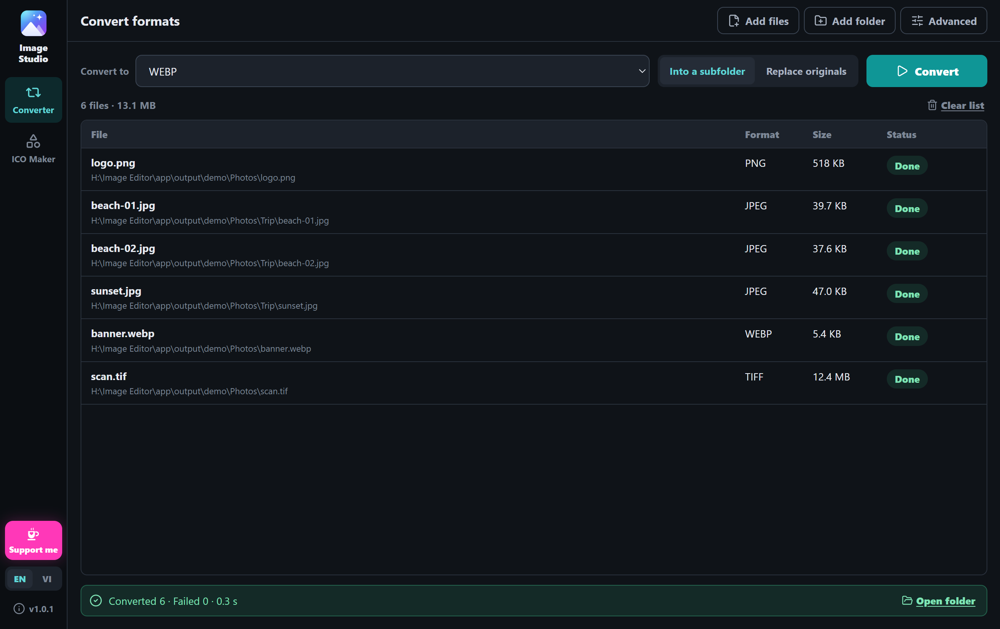
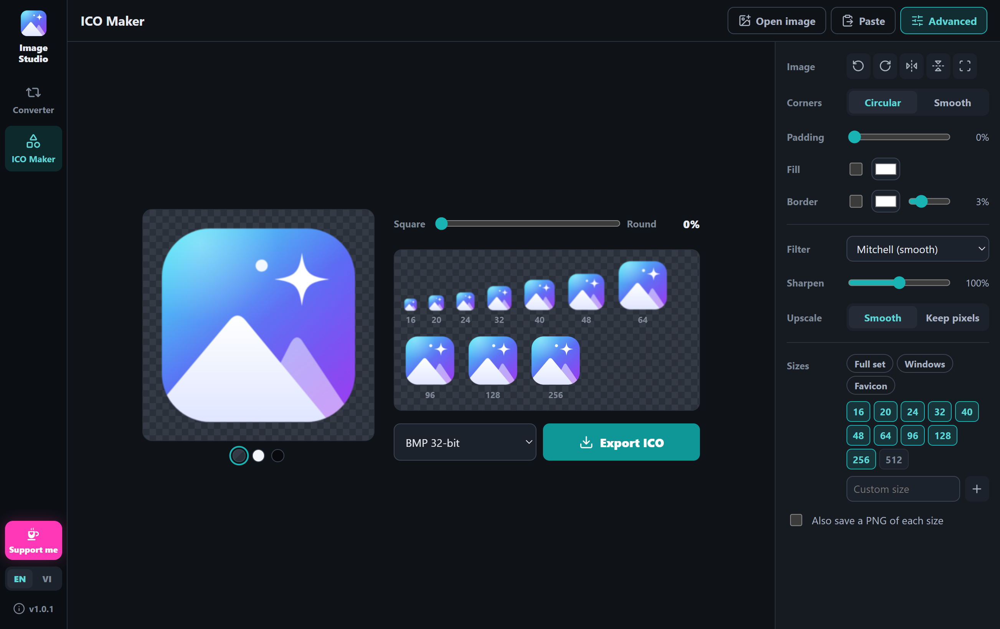

<div align="center">



# Image Studio

**Convert whole folders of images and PDFs to JPG, PNG, WEBP, AVIF and 100+ other formats in one go, and turn any picture into a crisp, multi-size Windows icon.**<br />
A free, open-source desktop app for Windows. It works offline, and your files never leave your computer.

**English** · [Tiếng Việt](docs/README.vi.md)

[](https://github.com/nyankuro/image-studio/releases/latest)

[](LICENSE)
[](https://ko-fi.com/nyannyankuro)



</div>

## ✨ What it does

**Converter**

- 📂 **Whole folders at once.** Drop in files or folders (subfolders included) and convert everything to JPG, PNG, WEBP, AVIF, TIFF, GIF, ICO, PDF or 100+ other formats.
- 📱 **iPhone photos too.** HEIC/HEIF, WEBP, AVIF, RAW camera files, PSD, SVG and more can be read and turned into everyday JPG or PNG.
- 📄 **PDF to images.** Every page becomes its own image, at the resolution you pick (72 to 600 DPI).
- 🛡️ **Your originals stay safe.** Results go into a subfolder by default. If you choose to replace the originals, a file is only removed after its new version has been written.
- ⚡ **Fast.** Several files are converted side by side, tuned to your CPU and memory, and you can stop at any moment.

**ICO Maker**

- 📋 **Paste and go.** Copy a picture from anywhere (a screenshot, an image in your browser, a file in Explorer) and press **Ctrl+V**. It shows up right away, ready to export.
- 🔍 **Sharp at every size.** Each size, from 16 px up to 256 px, is resized on its own with high-quality filters and a touch of sharpening, so small icons stay crisp instead of blurry or jagged.
- ✂️ **Frame it your way.** Drag to move, scroll to zoom, and round the corners anywhere from square to a full circle. Add padding, a background color or a border if you like.
- 🧩 **Every ICO flavor.** BMP 32-bit with transparency, PNG, BMP 24-bit, 8-bit (256 colors) and 4-bit (16 colors), with presets for Windows apps and website favicons, plus any custom size up to 1024 px.

And: English and Vietnamese, a calm dark theme, a layout that fits small windows, no ads, no account and no tracking.

<div align="center">

</div>

## 📥 Download

1. Open the [**latest release**](https://github.com/nyankuro/image-studio/releases/latest).
2. Pick one:
   - **`ImageStudio-Setup-x.y.z.exe`** is the installer, and the easy choice. It adds Start menu and desktop shortcuts and doesn't need admin rights.
   - **`ImageStudio-Portable-x.y.z-win-x64.zip`** is the portable version. Unzip it anywhere (a USB stick works too) and run `Image Studio.exe`.
3. Open it. If a blue *"Windows protected your PC"* box appears, click **More info → Run anyway**. ([Why does this happen?](#is-it-safe))

ImageMagick, the engine behind the converter, is built in, so there's nothing else to install. Only PDF files need one extra free program (see [PDF files](#pdf-files)).

To uninstall, go to **Windows Settings → Apps → Image Studio**.

### Is it safe?

Yes. The blue box only means the app is new and isn't code-signed yet (a signing certificate costs money every year). It is **not** a virus warning.

Want to check for yourself?

- Every download is built automatically by GitHub from the source code you can read here, not on someone's PC. You can follow each build under [Actions](https://github.com/nyankuro/image-studio/actions).
- The app doesn't send your pictures or anything else anywhere. It only goes online when you click **Check for updates** (it asks GitHub for the newest version number) or one of its links.
- Please download Image Studio only from this GitHub page. Copies on other sites may have been changed.

## 📖 How to use

### Convert images

1. Open **Converter** and drop files or folders onto the window, or click **Add files** / **Add folder**.
2. Pick a format in **Convert to**.
3. Choose where the results go:
   - **Into a subfolder** (default): a `converted-images` folder next to the originals. The originals aren't touched.
   - **Replace originals**: the results are saved next to the originals, and each original is deleted once its new version is written.
4. Click **Convert**. You can click **Stop** at any time; files that were in progress are cleaned up, so nothing is left half-written. When it's done, **Open folder** shows the results.

In **Advanced**:

- **Quality**: *Lossless* keeps every pixel when the format allows it (PNG, TIFF, WEBP, AVIF, JXL), with larger files. *Max quality* uses the highest quality setting with normal compression, with smaller files. JPEG always uses its best quality.
- **PDF**: the resolution for PDF pages: 72, 150, 300 or 600 DPI. 300 DPI suits most documents.
- **Subfolder**: the name of the results folder.
- **Folder filter**: when you add a folder, only take files of one format (for example only HEIC photos). Files you add one by one are always included.

#### PDF files

To read PDFs, ImageMagick needs **Ghostscript**, a free program that can't be bundled with this app for license reasons. If it's missing, Image Studio tells you and links to the [Ghostscript download page](https://ghostscript.com/releases/gsdnld.html). Install the 64-bit version, then try again. Each page becomes its own image; with *Replace originals*, the pages go into a folder named after the PDF.

### Make an icon in three steps

1. Copy a picture and press **Ctrl+V** in **ICO Maker**. You can also drag a picture into the window or click **Open image**.
2. Drag the picture to frame it and scroll to zoom. Move the slider from **Square** to **Round** for rounded corners.
3. Click **Export ICO** and choose where to save it.

A few handy things:

- **Double-click** the preview to reset the framing. The arrow keys nudge the picture, and **+** / **–** zoom.
- **Click a size** in the strip under the slider to see it enlarged pixel by pixel. Click it again to go back.
- The **three dots** under the preview switch its background (checkerboard, light, dark), so you can check how the icon looks on light and dark taskbars.
- Pasting something that isn't a picture, such as plain text, does nothing, so you never lose your work by accident.
- Pasting the path of an image file (for example `C:\Pictures\logo.png`) opens that file.

#### Which ICO format should I pick?

| Format | Good for |
|---|---|
| **BMP 32-bit** (default) | Windows apps, shortcuts and folders. Full transparency, works everywhere. |
| **PNG 32-bit** | Smaller files. Works on Windows Vista and newer and in web browsers. |
| **BMP 24-bit** | Old programs that don't understand transparency. Edges are hard, not soft. |
| **BMP 8-bit · 256 colors**, **4-bit · 16 colors** | Very old systems, or a retro look. |

Sizes above 256 px are always stored as PNG, because that's the only way the ICO format allows them.

#### Advanced options

Click **Advanced** to open the side panel:

- **Image**: rotate, flip, or reset the framing.
- **Corners**: *Circular* gives classic rounded corners; *Smooth* gives softer, app-style corners.
- **Padding**: empty space between the picture and the edge of the icon.
- **Fill** and **Border**: a solid background (handy for pictures with transparent parts) or an outline.
- **Filter**: how the picture is shrunk. *Mitchell* is smooth (the default); *Magic Kernel Sharp* is crisper.
- **Sharpen**: extra sharpening for small sizes. 100% is automatic; 0% turns it off.
- **Upscale**: when the picture is smaller than the icon, enlarge it smoothly, or *Keep pixels* for pixel art.
- **Sizes**: presets (*Full set*, *Windows*, *Favicon*). Click a size to turn it on or off, or type your own.
- **Also save a PNG of each size**: writes a folder of PNG files next to the .ico.

## Questions

**Can it convert iPhone photos (HEIC) to JPG?**
Yes. Drop the photos or their folder into **Converter**, pick **JPEG** in **Convert to** and click **Convert**.

**Does it need the internet?**
No. Everything happens on your computer. The only online feature is **Check for updates**, and it runs only when you click it.

**Where are my settings saved?**
In `%APPDATA%\image-studio`. Deleting that folder resets the app to its defaults.

**Can I use the icons I make in my own projects, even commercial ones?**
Yes. What you make with Image Studio is yours. The app's license covers only the app's own code.

**How do I switch the language?**
Use the **EN / VI** switch at the bottom left. The app remembers your choice.

**Something doesn't work.**
Please [open an issue](https://github.com/nyankuro/image-studio/issues) with what you did and, if you can, a screenshot. The app version is shown at the bottom left (click it for **About**).

## ☕ Support

Image Studio is free, and it's going to stay that way. If it saved you some time, maybe chip in a little for my instant noodles 😽:

<a href="https://ko-fi.com/nyannyankuro"></a>

There's also a pink **Support me** button in the app, at the bottom left. Thank you so much ❤️ Other ways to help:

- ⭐ **Give the project a star.** It helps other people find it.
- 🐛 **Tell me about bugs or ideas** in [Issues](https://github.com/nyankuro/image-studio/issues).

## For developers

<details>
<summary><b>Build from source</b></summary>

You need Windows 10/11 and [Node.js](https://nodejs.org/) 22 or newer. For the PDF tests, install [Ghostscript](https://ghostscript.com/releases/gsdnld.html) too.

```bash
git clone https://github.com/nyankuro/image-studio.git
cd image-studio
npm ci
npm run fetch:magick   # downloads the pinned portable ImageMagick into vendor/
npm run dev            # run with live reload
npm test               # unit and conversion tests, then the Electron UI smoke tests
npm run package        # build release/win-unpacked and put a shortcut on the desktop
npm run dist           # build the installer and portable zip into release/
```

`npm run fetch:magick` checks the SHA-256 of the download and keeps only `magick.exe` and the files it needs (about 32 MB). Without it, the app falls back to a `magick` command on your PATH.

Project layout: `electron/` (main process: ImageMagick, conversion queue, clipboard, update check), `src/` (React interface; `src/lib/` holds the icon resampling, ICO encoder and color quantizer), `locales/` (English and Vietnamese text), `tests/`, `scripts/` (ImageMagick download, desktop shortcut).

To release a new version, update `version` in `package.json` and `CHANGELOG.md`, write the release notes in `docs/release-notes/vX.Y.Z.md`, then push a tag such as `v1.0.2` or click **Run workflow** on the `release` workflow in the Actions tab. GitHub Actions runs the tests, builds the installer and the portable zip, and publishes them as a GitHub Release with those notes and the SHA-256 checksums.

To add a language, copy `locales/en.json`, translate the values, and register it in `src/i18n.jsx` and `electron/i18n.cjs`.

</details>

## 📄 License

© 2026 nyankuro. Image Studio is **free and open source** under the [GNU General Public License v3.0 or later](LICENSE). In plain words:

- ✅ You can use it for free, at home or at work, share it, and change it.
- 🔓 If you share a changed or rebranded copy (even for money), you must keep it under the same license, publish its source code and keep the original credits.

Powered by [ImageMagick](https://imagemagick.org/) (ImageMagick License), bundled unmodified. Other parts keep their own licenses; see [THIRD_PARTY_NOTICES.md](THIRD_PARTY_NOTICES.md). Inspired by the handy online tools at [RedKetchup](https://redketchup.io/).

<div align="center">

Made with ❤️ by nyankuro 🐈‍⬛

</div>
