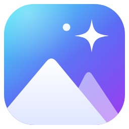
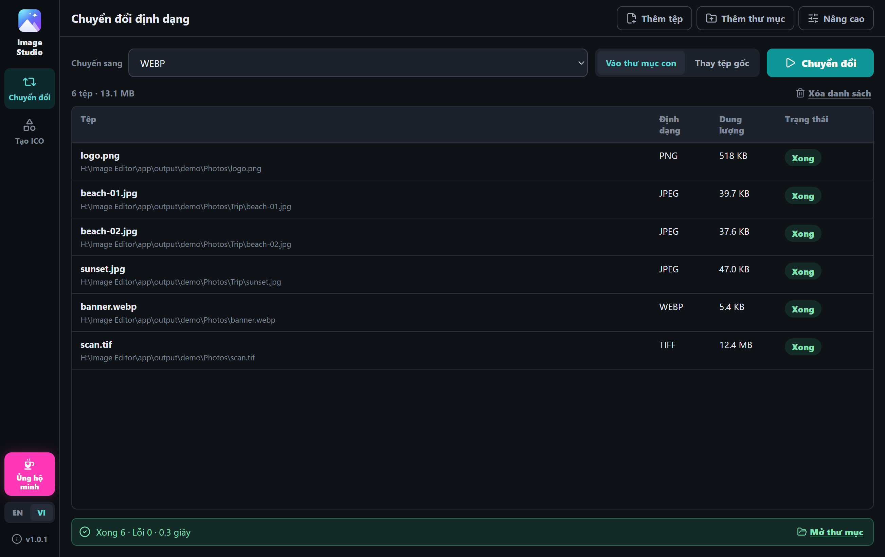
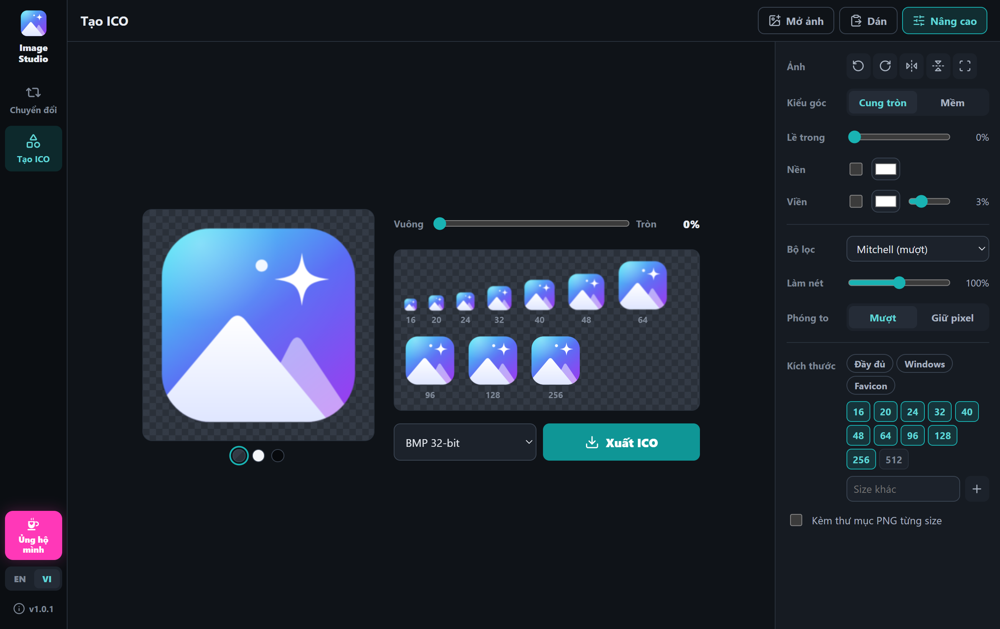

# Image Studio

**Chuyển đổi cả thư mục ảnh lẫn PDF sang JPG, PNG, WEBP, AVIF và hơn 100 định dạng khác trong một lần, và biến bất kỳ bức ảnh nào thành icon Windows sắc nét đủ mọi kích thước.** 
Ứng dụng miễn phí, mã nguồn mở cho Windows. Chạy không cần mạng, ảnh của bạn không bao giờ rời khỏi máy.

[English](../README.md) · **Tiếng Việt**

## ✨ Làm được gì

**Chuyển đổi định dạng**

- 📂 **Cả thư mục một lần.** Kéo-thả tệp hoặc thư mục (gồm cả thư mục con) rồi chuyển hết sang JPG, PNG, WEBP, AVIF, TIFF, GIF, ICO, PDF hoặc hơn 100 định dạng khác.
- 📱 **Cả ảnh iPhone.** Đọc được HEIC/HEIF, WEBP, AVIF, ảnh RAW máy ảnh, PSD, SVG và nhiều loại khác, rồi đổi sang JPG hay PNG quen thuộc.
- 📄 **PDF thành ảnh.** Mỗi trang thành một ảnh riêng, ở độ phân giải bạn chọn (72 đến 600 DPI).
- 🛡️ **Tệp gốc luôn an toàn.** Mặc định kết quả được lưu vào thư mục con. Nếu chọn thay tệp gốc, mỗi tệp chỉ bị xóa sau khi bản mới đã ghi xong.
- ⚡ **Nhanh.** Nhiều tệp được chuyển cùng lúc, tự điều chỉnh theo CPU và RAM, và bạn có thể dừng bất cứ lúc nào.

**Tạo ICO**

- 📋 **Dán là xong.** Sao chép ảnh ở bất cứ đâu (ảnh chụp màn hình, ảnh trên trình duyệt, tệp trong Explorer) rồi nhấn **Ctrl+V**. Ảnh hiện ra ngay, sẵn sàng để xuất.
- 🔍 **Nét ở mọi kích thước.** Mỗi size từ 16 px đến 256 px được thu nhỏ riêng bằng bộ lọc chất lượng cao và làm nét nhẹ, nên icon nhỏ vẫn sắc chứ không mờ hay răng cưa.
- ✂️ **Cắt khung theo ý bạn.** Kéo để dời ảnh, cuộn chuột để phóng to, bo góc từ vuông đến tròn hẳn. Thêm lề, màu nền hoặc viền nếu muốn.
- 🧩 **Đủ kiểu ICO.** BMP 32-bit có nền trong suốt, PNG, BMP 24-bit, 8-bit (256 màu) và 4-bit (16 màu), có sẵn bộ size cho app Windows và favicon web, thêm size tùy ý đến 1024 px.

Ngoài ra: giao diện tiếng Việt và tiếng Anh, nền tối dịu mắt, vừa cả khi cửa sổ nhỏ, không quảng cáo, không cần tài khoản, không theo dõi.

## 📥 Tải về

1. Mở [**bản phát hành mới nhất**](https://github.com/nyankuro/image-studio/releases/latest).
2. Chọn một trong hai:
   - **`ImageStudio-Setup-x.y.z.exe`** là bộ cài, cách dễ nhất. Bộ cài tạo shortcut ở Start menu và màn hình Desktop, không cần quyền admin.
   - **`ImageStudio-Portable-x.y.z-win-x64.zip`** là bản portable. Giải nén ở đâu cũng được (cả USB) rồi chạy `Image Studio.exe`.
3. Mở app. Nếu hiện khung xanh *"Windows protected your PC"*, bấm **More info → Run anyway**. ([Vì sao lại hiện?](#có-an-toàn-không))

ImageMagick, bộ máy chuyển đổi ảnh, đã có sẵn trong app nên không phải cài thêm gì. Chỉ tệp PDF mới cần thêm một chương trình miễn phí (xem [Tệp PDF](#tệp-pdf)).

Muốn gỡ app: vào **Settings của Windows → Apps → Image Studio**.

### Có an toàn không?

Có. Khung xanh đó chỉ có nghĩa là app còn mới và chưa được ký số (chứng chỉ ký số tốn tiền mỗi năm). Đó **không** phải cảnh báo virus.

Muốn tự kiểm tra?

- Mọi bản tải về đều do GitHub tự dựng từ chính mã nguồn bạn đọc được ở đây, không dựng trên máy ai cả. Bạn xem từng lần dựng ở mục [Actions](https://github.com/nyankuro/image-studio/actions).
- App không gửi ảnh hay bất cứ thứ gì đi đâu. App chỉ lên mạng khi bạn bấm **Kiểm tra cập nhật** (hỏi GitHub số phiên bản mới nhất) hoặc bấm một đường link.
- Hãy chỉ tải Image Studio từ trang GitHub này. Bản ở trang khác có thể đã bị sửa.

## 📖 Hướng dẫn sử dụng

### Chuyển đổi định dạng ảnh

1. Mở mục **Chuyển đổi** rồi kéo-thả tệp hoặc thư mục vào cửa sổ, hoặc bấm **Thêm tệp** / **Thêm thư mục**.
2. Chọn định dạng ở ô **Chuyển sang**.
3. Chọn cách lưu kết quả:
   - **Vào thư mục con** (mặc định): thư mục `converted-images` nằm cạnh tệp gốc. Tệp gốc giữ nguyên.
   - **Thay tệp gốc**: kết quả lưu cạnh tệp gốc, và mỗi tệp gốc bị xóa khi bản mới của nó đã ghi xong.
4. Bấm **Chuyển đổi**. Bấm **Dừng** lúc nào cũng được; tệp đang làm dở sẽ được dọn đi, không để lại tệp hỏng. Xong thì bấm **Mở thư mục** để xem kết quả.

Trong **Nâng cao**:

- **Chất lượng**: *Không mất* giữ nguyên từng pixel khi định dạng cho phép (PNG, TIFF, WEBP, AVIF, JXL), tệp lớn hơn. *Cao nhất* dùng mức chất lượng cao nhất với nén thường, tệp nhỏ hơn. JPEG luôn ở chất lượng tốt nhất.
- **PDF**: độ phân giải cho trang PDF: 72, 150, 300 hoặc 600 DPI. 300 DPI hợp với hầu hết tài liệu.
- **Thư mục con**: tên thư mục chứa kết quả.
- **Lọc thư mục**: khi thêm thư mục, chỉ lấy tệp của một định dạng (ví dụ chỉ ảnh HEIC). Tệp thêm từng cái thì luôn được lấy.

#### Tệp PDF

Để đọc PDF, ImageMagick cần **Ghostscript**, một chương trình miễn phí nhưng không được kèm vào app vì lý do giấy phép. Nếu máy chưa có, Image Studio sẽ báo và đưa link tới [trang tải Ghostscript](https://ghostscript.com/releases/gsdnld.html). Cài bản 64-bit rồi thử lại. Mỗi trang thành một ảnh; ở chế độ *Thay tệp gốc*, các trang nằm trong thư mục mang tên tệp PDF.

### Tạo icon trong ba bước

1. Sao chép một bức ảnh rồi nhấn **Ctrl+V** ở mục **Tạo ICO**. Cũng có thể kéo-thả ảnh vào cửa sổ hoặc bấm **Mở ảnh**.
2. Kéo ảnh để chọn khung, cuộn chuột để phóng to. Kéo thanh trượt từ **Vuông** sang **Tròn** nếu muốn bo góc.
3. Bấm **Xuất ICO** rồi chọn chỗ lưu.

Vài mẹo nhỏ:

- **Nhấp đúp** vào khung xem trước để đặt lại khung. Phím mũi tên dời ảnh từng chút, **+** / **–** để phóng to, thu nhỏ.
- **Bấm vào một size** trong dải bên dưới thanh trượt để xem phóng to từng pixel. Bấm lần nữa để quay lại.
- **Ba chấm tròn** dưới khung xem trước đổi nền xem thử (kẻ ô, sáng, tối), để xem icon trông thế nào trên thanh taskbar sáng và tối.
- Dán thứ không phải ảnh, như một đoạn chữ, thì app không làm gì cả, nên không bao giờ mất ảnh đang làm.
- Dán đường dẫn tới một tệp ảnh (ví dụ `C:\Pictures\logo.png`) sẽ mở tệp đó.

#### Nên chọn định dạng ICO nào?

| Định dạng | Hợp với |
|---|---|
| **BMP 32-bit** (mặc định) | App, shortcut và thư mục trên Windows. Trong suốt đầy đủ, chạy ở mọi nơi. |
| **PNG 32-bit** | Tệp nhỏ hơn. Chạy trên Windows Vista trở lên và trên trình duyệt web. |
| **BMP 24-bit** | Phần mềm cũ không hiểu nền trong suốt. Viền cứng, không mềm. |
| **BMP 8-bit · 256 màu**, **4-bit · 16 màu** | Máy rất cũ, hoặc muốn kiểu hoài cổ. |

Size trên 256 px luôn được lưu dạng PNG, vì định dạng ICO chỉ cho phép như vậy.

#### Tùy chọn nâng cao

Bấm **Nâng cao** để mở bảng bên phải:

- **Ảnh**: xoay, lật, hoặc đặt lại khung.
- **Kiểu góc**: *Cung tròn* là góc bo cổ điển; *Mềm* là góc mềm hơn, kiểu icon app điện thoại.
- **Lề trong**: khoảng trống giữa ảnh và mép icon.
- **Nền** và **Viền**: tô một màu nền (hợp với ảnh có phần trong suốt) hoặc thêm đường viền.
- **Bộ lọc**: cách thu nhỏ ảnh. *Mitchell* mượt (mặc định); *Magic Kernel Sharp* nét hơn.
- **Làm nét**: làm nét thêm cho size nhỏ. 100% là tự động; 0% là tắt.
- **Phóng to**: khi ảnh nhỏ hơn icon thì phóng to cho *Mượt*, hoặc *Giữ pixel* cho ảnh pixel art.
- **Kích thước**: bộ size có sẵn (*Đầy đủ*, *Windows*, *Favicon*). Bấm vào size để bật hoặc tắt, hoặc gõ size riêng.
- **Kèm thư mục PNG từng size**: lưu thêm một thư mục ảnh PNG cạnh tệp .ico.

## Câu hỏi thường gặp

**Đổi ảnh iPhone (HEIC) sang JPG được không?**
Được. Kéo ảnh hoặc cả thư mục ảnh vào mục **Chuyển đổi**, chọn **JPEG** ở ô **Chuyển sang** rồi bấm **Chuyển đổi**.

**App có cần mạng không?**
Không. Mọi thứ chạy trên máy bạn. Tính năng duy nhất dùng mạng là **Kiểm tra cập nhật**, và chỉ chạy khi bạn bấm.

**Thiết lập được lưu ở đâu?**
Trong `%APPDATA%\image-studio`. Xóa thư mục đó thì app trở về mặc định.

**Icon tôi tạo có dùng được cho dự án riêng, kể cả thương mại không?**
Được. Thứ bạn tạo bằng Image Studio là của bạn. Giấy phép của app chỉ áp dụng cho mã nguồn của chính app.

**Đổi ngôn ngữ thế nào?**
Dùng nút **EN / VI** ở góc dưới bên trái. App nhớ lựa chọn của bạn.

**Có gì đó không chạy.**
Hãy [tạo một issue](https://github.com/nyankuro/image-studio/issues), kể bạn đã làm gì và gửi kèm ảnh chụp màn hình nếu được. Phiên bản app hiện ở góc dưới bên trái (bấm vào để mở **Giới thiệu**).

## ☕ Ủng hộ

Image Studio miễn phí và sẽ luôn như vậy. Nếu app giúp bạn tiết kiệm chút thời gian, hãy cân nhắc ủng hộ tôi ít tiền mua mì gói nhé 😽:

Trong app cũng có nút hồng **Ủng hộ mình** ở góc dưới bên trái. Cảm ơn bạn rất nhiều ❤️ Những cách giúp khác:

- ⭐ **Tặng dự án một ngôi sao.** Nhờ vậy người khác dễ tìm thấy hơn.
- 🐛 **Báo lỗi hoặc góp ý** ở mục [Issues](https://github.com/nyankuro/image-studio/issues).

## Dành cho lập trình viên

Xem phần *For developers* trong [README tiếng Anh](../README.md#for-developers).

## 📄 Giấy phép

© 2026 nyankuro. Image Studio là phần mềm **miễn phí và mã nguồn mở** theo [Giấy phép Công cộng GNU v3.0 trở lên](../LICENSE). Nói đơn giản:

- ✅ Bạn được dùng miễn phí, ở nhà hay ở công ty, được chia sẻ và sửa đổi.
- 🔓 Nếu chia sẻ bản đã sửa hoặc đổi tên (kể cả bán), bạn phải giữ nguyên giấy phép này, công khai mã nguồn và giữ ghi công gốc.

Dùng [ImageMagick](https://imagemagick.org/) (giấy phép ImageMagick), đi kèm nguyên bản. Các thành phần khác giữ giấy phép riêng; xem [THIRD_PARTY_NOTICES.md](../THIRD_PARTY_NOTICES.md). Lấy cảm hứng từ các công cụ trực tuyến tiện lợi của [RedKetchup](https://redketchup.io/).

Làm với ❤️ bởi nyankuro 🐈‍⬛

